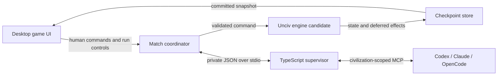

# Unciv with Agent-Controlled Civilizations

Created and expanded: 2026-09-14

**Status:** Fork, clone, and planning document complete. Gameplay changes, provider integration, tool-isolation validation, JDK setup, builds, and gameplay tests are not implemented or verified yet.

| Item | Value |
| --- | --- |
| Fork / `origin` | https://github.com/NACC96/Unciv |
| Original repository / `upstream` | https://github.com/yairm210/Unciv |
| Local checkout | `/Volumes/Lexar/Unciv` |
| Inspected starting revision | `518daddf0a06b273f16b481a0464626889307df7` |
| First release | Local macOS desktop; complete Civ V - Vanilla matches |

This is the implementation contract for the first release. Development milestones below are intermediate gates, not reductions of the final scope. All source paths are relative to this repository. Check this revision against the implementation branch before relying on line numbers or existing APIs.

## 1. Product contract

### 1.1 Goal and agreed experience

Let the user watch AI agents play Unciv and play in the same matches as those agents, with reliable turn control and understandable decisions.

- Support both agent-only spectator matches and local human-plus-agent matches. Existing local hotseat behavior remains available for multiple human slots.
- Assign Human, Built-in AI, or External Agent to each major civilization. External providers are **Codex, Claude, and OpenCode**, mixed freely within a match.
- External agents make all player decisions available in the supported ruleset, including individual unit actions. They interact with game tools rather than clicking the interface or editing save files.
- Each agent has a persistent identity, provider/model settings, supported reasoning setting, custom display name, personality instructions, and private strategy notes.
- Keep the desktop map and normal game screens; add configuration, status, inspection, and run controls using the existing UI conventions.
- Agents always receive their civilization's permitted information. Human matches default to normal visibility. An explicit saved match option permits omniscient human inspection; agent-only spectators can inspect everything.
- Confirmed agent failure pauses the match. Recovery offers retry, provider change, or human takeover; no silent built-in AI substitution.

### 1.2 First-release boundaries

- Agent-enabled matches use the installed **Civ V - Vanilla** ruleset without mods. Explicitly select it: upstream new-game defaults currently select Gods & Kings.
- Disable and lock espionage for agent-enabled matches. Vanilla disables religion, but espionage is a separate game setting and is not excluded merely by selecting Vanilla.
- Cover all five Vanilla victory types: Scientific, Cultural, Domination, Diplomatic, and Time.
- City-states, barbarians, and explicitly configured Built-in AI major civilizations retain their ordinary automation.
- Keep standard game-rule effects such as puppet-city management and citizen reassignment after population changes. Suppress unsolicited strategic automation for external agents, including global auto-production, auto-bombardment, auto-explore, and worker automation.
- Permit explicit persistent orders such as a chosen movement destination, fortification, or construction of a chosen improvement. Those orders are distinct from delegating strategy to the built-in AI.
- Preserve ordinary non-agent games, existing save loading, and existing simulation behavior. Agent matches must not use the legacy simulation/full-autoplay path.
- Defer online multiplayer, browser UI, headless tournaments, arbitrary provider plugins, mods, expansion mechanics, inter-agent free-form chat, public distribution infrastructure, and strategic-strength benchmarking.
- Complete-game capability is required. Strong play and provider rankings are separate tuning work.

### 1.3 Defaults and user authority

These are implementation defaults; they do not replace the user's settled choices above.

| Decision | Default / rule |
| --- | --- |
| Initial agent-match preset | Tiny map, Quick speed, Prince difficulty, Ancient era, all Vanilla victories enabled, standard turn limit; normal map options remain editable |
| Slot allocation | Fixed major-civilization slots when agents are configured; disable random player counts so no configured leader disappears |
| Provider/model | Require selection before first execution; reuse the last validated local profile thereafter; no silent substitution |
| New or loaded match | Paused until the user selects Run or Step |
| Concurrent execution | One active provider invocation per match; never resume the same leader session concurrently |
| Spectator perspective | Full-map view initially; chosen civilization perspective stays pinned while inspecting objects |
| Human perspective | Own civilization; omniscient inspection only when the saved full-inspection option is enabled |
| Guidance | Spectator may guide any external leader; a human may guide only a leader they explicitly control through takeover/delegation, not opponents |
| Provider/personality edits | Only while paused; apply at a new invocation with an explicit configuration-change event |
| Undo | Disable ordinary move undo in agent-enabled matches initially; preserve it for ordinary games |
| Agent failure | Pause with a specific reason and retain committed moves |
| Resource guards | 500 game-tool calls per civilization turn, 10 consecutive invalid mutations; reaching either pauses at a safe boundary and can be extended explicitly |

The call guards are adjustable operational limits, not monetary caps or wall-clock deadlines. Do not stop a slow or quiet provider merely because time has elapsed. Full-inspection mode affects viewing, not permission to control opponents.

## 2. Verified code constraints

The following findings must influence implementation rather than being rediscovered after integration.

| Area | Existing behavior | Required consequence |
| --- | --- | --- |
| `logic/GameInfo.kt`, `logic/civilization/managers/TurnManager.kt` | `nextTurn()` combines end/start effects, built-in automation, round counters, and stopping at a human | Extract resumable boundaries while retaining a legacy adapter |
| `logic/civilization/PlayerType.kt`, `Civilization.kt`, `GameStarter.kt` | Human/AI classification affects starting units, bonuses, research, and other rules | Keep external agents in the Human rule category; add a separate controller category |
| `ui/screens/newgamescreen/PlayerPickerTable.kt`, `NewGameScreen.kt` | Setup currently requires at least one human slot | Admit all-agent matches with a non-competing observer |
| `UncivGame.kt`, `GameInfo.getPlayerToViewAs()` | Offline viewing and hotseat transitions assume a Human is locally controlled | Route these by controller identity, not rule identity |
| `ui/screens/worldscreen/WorldScreen.kt` | Turn processing works on a clone in a worker and later replaces the screen; selected and viewing civilizations are already separate | Extend snapshot publication and spectator behavior rather than creating a second game renderer |
| `view/View.kt`, `TileView.kt`, `ForeignCivView.kt` | Views are an incomplete migration: raw-object accessors, direct resource fields, and some unchecked setters remain | Export explicit allowlisted DTOs; views alone are not a complete permission boundary |
| `GameInfo.clone()`, `Civilization.clone()`, `logic/trade/Trade.kt` | Clones share mutable parameters, some alerts/requests, and trade offers | Do not use the current clone implementation as transaction isolation |
| `UnitActionsFromUniques.kt`, `logic/battle/Battle.kt` | Some actions read global screens/settings or open confirmation/conquest UI | Extract semantic commands with explicit execution policy and deferred presentation effects |
| `CityConstructions.kt`, `GameInfo.setTransients()` | Construction selection can run from global settings during ordinary work and transient restoration | Apply agent policy before restoring transients; restoration must not make unsolicited choices |
| `logic/files/UncivFiles.kt`, `json/UncivJson.kt` | Saves use Gdx JSON; JSON instances are not thread-safe and unknown fields are ignored | Use fresh serializers; add an explicit fork-format/version boundary for agent saves |
| `desktop/.../DesktopLauncher.kt` | `--data-dir=` already exists | Use a separate project-owned data directory instead of the ordinary Unciv profile |
| `settings.gradle.kts`, CI workflow | Desktop/core/tests can be included without an Android SDK; CI uses JDK 21 | Start with JDK 21 and the desktop build; no Android SDK required for the local milestone |

Useful entry points are under `core/src/com/unciv/` unless otherwise stated. Pin provider protocol fixtures as well as the engine revision; the installed CLIs can change independently of this repository.

## 3. Architecture and ownership

### 3.1 Components



- **Core game module:** controller metadata, turn stepper, observation exporter, pending-decision service, typed command handlers, and legality rules. It contains no Node/process-launch dependencies.
- **Desktop coordinator:** owns the active agent match, serializes changes, commits checkpoints, publishes render snapshots, and controls the supervisor. Only this layer may grant or revoke turn authority.
- **TypeScript supervisor:** launches provider CLIs, hosts the MCP endpoint, normalizes streamed events, and manages run/session metadata. It cannot mutate engine state directly or read whole saves on behalf of agents.
- **Existing desktop UI:** submits human commands and displays published state. Supervisor administration and omniscient observations are never agent tools.
- **Checkpoint store:** authoritative game/controller/decision state. Provider output and external JSONL logs are evidence, never the source of truth for applied moves.

Keep new code under small focused areas such as `core/src/com/unciv/logic/agents/`, `desktop/src/com/unciv/app/desktop/agents/`, and `agent-runner/`. Shared JSON schemas live under `agent-protocol/`. UI additions remain with their existing screens. These are planned locations, not existing implementation.

### 3.2 Single-writer and snapshot rules

1. A serial coordinator executor processes all mutations in an agent-enabled match: human commands, agent commands, turn transitions, and controller changes.
2. Build an unpublished candidate using a serialization roundtrip, with controlled transient restoration and agent execution policy installed before restoration. Start with correctness; replacing this with optimized cloning requires isolation tests and measured benefit.
3. Execute and validate the operation entirely on that candidate. Do not temporarily replace `UncivGame.Current` or the visible world screen with it.
4. Produce a new checkpoint containing the resulting game state and operation receipt. Commit it before acknowledging success.
5. Publish a separate render snapshot and deferred effects on the GL thread, then release the next command. The renderer never shares mutable engine objects with the working candidate.
6. On exception or failed checkpoint persistence, discard the candidate, preserve the prior committed state, and pause. No success receipt or gameplay effect may escape from the discarded candidate.

All state-changing human controls in agent-enabled matches must enter this path, including secondary city screens, diplomacy popups, keyboard shortcuts, and view `try...` methods. Existing normal games can retain their current path. A mutation audit is required; protecting only the map's primary buttons is insufficient.

Snapshot replacement must rebind cities, units, tile selections, open inspectors, and pending choices by stable IDs. Preserve camera/zoom/pinned perspective; close inspectors for removed objects with a clear explanation. Do not rebuild the whole UI on provider text events. Expensive copying, serialization, rules processing, and log parsing stay off the GL thread.

### 3.3 Execution context

Give semantic handlers an explicit context containing the candidate game, acting civilization, controller policy, and a collector for resulting presentation events. Game-rule code must not infer agent policy from global UI autoplay or user settings.

Preserve normal human rule treatment for external agents. Audit `isHuman()`, `isAI()`, direct `PlayerType` comparisons, and global automation settings, categorizing each use as game rules, controller routing, or presentation. Change only the relevant routing/presentation uses.

## 4. State, identity, and turn lifecycle

### 4.1 Minimum types

| Type | Required fields / meaning |
| --- | --- |
| `ControllerKind` | `HUMAN`, `BUILTIN_AI`, `EXTERNAL_AGENT`; independent of `PlayerType` |
| `AgentProfile` | Profile ID, display name, provider, model ID, optional supported reasoning setting, personality, profile revision |
| `CivilizationController` | Existing civ ID, controller kind, optional copied agent profile; profile edits do not silently alter already-started matches |
| `AgentMatchState` | Format version, match ID, timeline ID, state revision, turn serial, turn phase, controller map, visibility policy, private notes, pending decisions, guidance queue, operation receipts |
| `RunBinding` | Match/timeline/civ/provider/configuration fingerprint, invocation ID, returned provider session ID, highest state revision delivered to that session, local process identity and lifecycle status |
| `PendingDecision` | Stable decision ID, type, owning civ, source entity/event, mandatory/optional/informational classification, typed options, expiry or invalidation condition |
| `ActionReceipt` | Application action ID, actor/timeline, request fingerprint, before/after revision, outcome, sanitized result and committed event IDs |

Use existing civilization IDs, city IDs, unit integer IDs, and engine hex coordinates. Names and translated labels are display values, not identifiers. Document hex coordinates as the engine's coordinate pair, including map wrapping; do not silently convert to screen coordinates.

If agent metadata is attached to `GameInfo`, use the existing serialization constraints: concrete serializable classes, no-argument construction as needed, string map keys, and transient runtime-only fields. Deep-copy all new mutable metadata. Mutable game parameters must not be shared between unpublished and published states.

### 4.2 Durable turn phases

| Phase | Allowed work | Transition |
| --- | --- | --- |
| `READY_TO_START` | Apply start-turn effects exactly once for the next eligible civ | Commit `AWAITING_DECISIONS` |
| `AWAITING_DECISIONS` | Human/agent commands, required decisions, or built-in automation according to controller | Explicit validated end-turn commits `READY_TO_END` |
| `READY_TO_END` | Apply end-turn effects once, update rankings/round rollover, select next eligible civ | Commit next `READY_TO_START`, or `COMPLETED` |
| `COMPLETED` | Inspection and save/export only | Explicit user “One more turn” may reopen play under normal rules |

Start and end transitions are atomic candidate operations; an intermediate “applying” state is UI/process status, not a partially saved game. Persist phase and turn serial so load/retry cannot re-award yields, complete research twice, reset movement twice, or skip a civ.

Retain upstream order for city/unit processing, research, production, notifications, diplomacy, ranking snapshots, barbarians, defeat skipping, and victory evaluation. Internal operations receive coordinator-generated IDs and the same commit discipline as player commands.

Built-in AI uses the same boundaries but executes its existing automation internally. It never requires a provider. An eliminated external civilization receives no new invocation. After victory, stop scheduling new work, save final state, revoke active mutation authority, and show the existing victory experience. A zero-survivor/no-next-player condition must terminate or pause with a reason, never spin.

Preserve ordinary `GameInfo.nextTurn()` and simulation through a compatibility adapter. Agent-enabled matches explicitly reject the simulation/full-autoplay execution route. All-agent matches use a non-competing observer, never a dummy competing civilization whose turns need manual advancement.

## 5. Game-tool protocol and information visibility

### 5.1 Public tool surface

Expose a small fixed tool catalog; action schemas remain typed and discoverable without installing hundreds of tools.

| Tool | Contract |
| --- | --- |
| `game.observe` | Current permitted overview, state revision, active-turn status, required decisions, recent visible events; detailed sections are requested/paginated |
| `game.inspect` | Permitted detail for an entity or map region; no hidden-entity discovery through IDs |
| `game.rules` | Search/read the pinned ruleset and relevant action help; static rules may be cached |
| `game.legal_actions` | Filter by action family/entity; typed arguments, costs, permitted targets, and visible reasons for restrictions |
| `game.act` | Submit one typed state-changing command with an application action ID and expected revision |
| `game.action_result` | Look up a prior action receipt without resubmitting an uncertain mutation |
| `game.notes` | Read/replace the acting leader's structured strategy notes with a notes revision |
| `game.end_turn` | Verify completion requirements and commit the end-turn request; never choose missing decisions automatically |

Example mutation envelope:

```json
{
  "protocolVersion": 1,
  "actionId": "unique-client-action-id",
  "expectedRevision": 42,
  "type": "unit.move",
  "args": { "unitId": 17, "destination": { "x": 2, "y": -1 } }
}
```

The supervisor supplies trusted match/timeline/civ/run/authority information based on the authenticated connection. The model cannot select its acting civilization or acquire authority through tool arguments. Kernel/controller validation remains in the Kotlin engine even after supervisor checks.

Example receipt:

```json
{
  "protocolVersion": 1,
  "actionId": "unique-client-action-id",
  "status": "applied",
  "revision": 43,
  "result": { "unitId": 17, "position": { "x": 2, "y": -1 } },
  "pendingDecisions": []
}
```

- Validate schema, authority, ownership, visibility, phase, expected revision, and game legality. Never dispatch by reflection or accept arbitrary function names, Kotlin code, shell code, paths, or save edits.
- Within authorized receipt scope, check a duplicate action ID before rejecting its old expected revision. Same ID and same request returns its original result; same ID with a different request is `ACTION_ID_CONFLICT`.
- A command may legally reveal tiles or change ownership. Return only information the acting civ is permitted to know after the action.
- Recompute options after every mutation. Listing an action is not a durable reservation of its cost, target, or eligibility.
- A pending action remains the one logical mutation in flight until it commits or is discarded. Duplicate submissions return its existing pending/terminal outcome; a different mutation ID receives `MUTATION_IN_PROGRESS`. `game.action_result` reports `pending`, `applied`, or `rejected`. Completing an HTTP request does not release this logical mutation slot.
- Do not batch mutations in v1. A single command may have ordinary multi-step engine consequences, but the client must observe those consequences before submitting its next command.
- Standard errors include `STALE_STATE`, `NOT_YOUR_TURN`, `MATCH_PAUSED`, `AUTHORITY_REVOKED`, `INVALID_ARGUMENT`, `ILLEGAL_ACTION`, `DECISIONS_PENDING`, `UNSUPPORTED_RULESET`, and `INTERNAL_ERROR`. Hidden and nonexistent entities receive the same externally safe response.
- An internal error pauses with a diagnostic ID; do not serialize stack traces or raw engine objects to the agent.

Keep schemas versioned in `agent-protocol/`; generate or validate Kotlin/TypeScript representations from these schemas in tests. Reject incompatible protocol/format versions explicitly. Unknown provider event fields may be tolerated; unknown gameplay command types may not.

### 5.2 Observation policy

Create explicit DTO builders with a field-by-field visibility inventory. Use existing view functions only where their permission behavior has been verified; never JSON-serialize a view or expose a `getCiv()`/`getTile()` result.

- **Own empire:** resources, yields, research, policies, cities, queues, specialists, units, movement, promotions, known diplomacy, and decision obligations available to a human controller.
- **Visible world:** only currently visible foreign units and permitted city/tile details, with normal invisible-unit/resource-discovery rules.
- **Explored but unseen world:** remembered information only to the extent the engine records it. Mark freshness/last observation where available; omit live foreign changes and values with no permitted remembered representation.
- **Unexplored world:** geometry needed to issue exploration moves may be represented as unknown; no terrain, resources, owners, entities, or hidden path blockage may leak through preview data.
- **Foreign civilizations:** only encountered civilizations and information actually available through ordinary game/diplomacy/ranking rules. Honor optional hidden-stat settings.
- **History:** export what the civ could observe at event time. Selecting omniscient UI later must not enrich agent history, notes, prompts, or events retrospectively.

Movement/attack previews and legal-action rejection reasons must obey the same visibility rules. Permit attempted exploration where normal human movement permits it; do not reveal hidden obstacles via a global “all valid destinations” oracle. Invalidate cached observations by match/timeline/civ/revision and visibility policy.

Use bounded section requests and pagination. Defaults: 100 entities per page, 20 recent visible events in the turn overview, 64 KiB maximum tool request, and 256 KiB maximum paged tool response. Return truncation/cursor metadata rather than silently dropping required decisions. Static rules are fetched on demand instead of repeating the whole Civilopedia each turn.

## 6. Vanilla gameplay coverage

Create `docs/agent-action-coverage.md` during implementation. Each row must identify the command schema, legality source, handler, result events, human UI path, and deterministic fixture. “Implemented” requires those links and a passing fixture, not merely a command name.

| Family | Required supported choices | Important fixtures |
| --- | --- | --- |
| Research | Select/change queue; choose free technologies; handle prerequisites and completed tree | Research completes at start; free tech cannot be selected illegally |
| Policies | Adopt policies/branches; choose free policies; preserve legally dismissible reminders | Free policy, branch completion, culture victory prerequisites |
| Cities | Found/rename; production queue ordering/removal; buildings/units/projects/perpetual production; purchase/sell where permitted | Empty queue, purchase placement blocked, wonder becomes unavailable |
| Population/economy | Citizen tile assignments/locks, specialists, city focus, tile purchases, permitted empire settings | Growth, starvation, insufficient gold, tiles no longer available |
| Civilian units | Settle, selected improvements, roads/repair, pillage where valid, sleep/skip/disband, gifts | Promise-breaking settlement, multi-turn work, recaptured civilian choice |
| Movement | Land/sea movement, embark/disembark, stacking, zone of control, explicit paths, exploration | Move reveals enemy; path interrupted; map wrap; no hidden-state preview |
| Land/naval combat | Melee/ranged attacks, city bombardment, siege setup, capture, healing/fortification, upgrades/promotions | Attacker dies; resource cost changes; city capture generates a decision |
| Air/special combat | Rebase/carriers, air strikes/interception/sweep, paradrop, nuclear attack where present in Vanilla | Range/slot limits, multiple-civ consequences, confirmation requirements |
| Great people | Free-person selections and each legal special action | Research/wonder hurry, golden age, improvement, trade mission |
| Diplomacy/trade | War/peace, offers, accept/decline/counteroffer, friendship, demands/promises, other Vanilla treaties | Expired or superseded offers, war invalidates trades, changing available resources |
| City-states | Gold/unit gifts, protection and responses, tribute, war/peace where legal | Insufficient gold, changed ally, protection conflict |
| Conquest/rewards | Annex/puppet/raze/liberate where legal, captured units, ruins/free-choice outcomes | Conquest without a world screen; liberation affects diplomacy |
| Victory | Spaceship-part construction/assembly, Utopia Project, capital capture, UN voting/abstention, score/time | Prepared endgame fixture for all five victories; stop scheduling after success |

The ruleset's actual reachable actions are authoritative. Inventory unique-triggered Vanilla actions too; the table is a coverage organization, not permission to omit an unusual legal action. An unsupported required choice must pause with its type/entity and a human recovery path; never auto-select an arbitrary option or silently skip it.

### 6.1 Pending decisions and confirmations

Build one core decision service from the behaviors currently spread across `NextTurnAction`, `WorldScreen` popup handling, trade/alert popups, and picker screens.

- **Mandatory:** choices that prevent legal continuation or must resolve a consequence, including conquest disposition and required rewards. `end_turn` returns them until resolved.
- **Optional/reminder:** ordinary idle-unit reminders and dismissible prompts. Provide explicit defer/skip actions when normal rules allow them; do not create deadlocks by treating every reminder as mandatory.
- **Informational:** notifications such as discoveries or completed buildings; log them without requiring agent acknowledgement unless the existing rules attach a choice.
- UI confirmations with gameplay consequences become explicit command arguments or decision objects containing the visible consequences. Agents do not wait on desktop confirmation dialogs.
- Decisions arising during a command are committed with that command. Resolve before unrelated actions when the game's consequence requires it; retain safe inspections and the decision's own resolution tools.
- Revalidate queued trade offers and other options immediately before applying. Closing a spectator inspector does not decline, acknowledge, or remove the acting civ's choice.
- Human-controlled decisions continue through normal picker screens, which submit the same semantic commands in agent-enabled matches.

## 7. Provider adapters, authentication, and packaging

### 7.1 Shared adapter contract

An adapter implements executable/version discovery, configuration validation, session start/resume, streamed-event normalization, completion classification, liveness inspection, and explicit user-requested cancellation. The supervisor owns policy; adapters only translate provider protocols.

Use one invocation per civilization turn by default, resuming the leader's recorded session. A paused/incomplete turn may require another invocation after the previous one exits. Never use “resume last,” `--continue`, or another directory-dependent heuristic to choose identity.

Normalize events into `run_started`, `session_bound`, `agent_message`, `tool_activity`, `usage`, `provider_retry`, `run_completed`, and `run_failed`. Keep these separate from authoritative `action_committed`, `decision_created`, `turn_ended`, and `match_finished` events from the engine.

CLI presence was verified during planning: Codex `0.154.0`, Claude Code `2.1.270`, OpenCode `1.18.31`. These are **candidate compatibility baselines**, not proven working integrations. Their effective tools, isolated authentication, event parsing, and MCP behavior must pass the early adapter gate.

### 7.2 Provider-specific starting points

| Provider | Invocation and identity | Configuration obligations |
| --- | --- | --- |
| Codex | `codex exec --json`; resume exact returned thread/session ID; capture final message when useful | `--ignore-user-config` is available and retains native auth; use explicit run overrides and a dedicated working directory; require game MCP; verify all unwanted built-in tools/instructions are excluded |
| Claude | `claude -p --output-format stream-json --verbose --include-partial-messages --include-hook-events`; exact session creation/resume IDs | Candidate restriction uses `--restricted`, `--tools ""`, `--strict-mcp-config`, explicit game-tool approvals, and noninteractive denial of unrelated requests; disable slash commands/browser; verify effective initialization metadata |
| OpenCode | `opencode run --format json`; resume `--session <exact-id>` | Use `--pure`, game-owned configuration, explicit deny-by-default tools with game MCP exceptions, sharing off; prove global configuration/instruction sources are excluded despite merge behavior |

These are starting points for adapter validation, not copy-and-run recipes. CLI flags/config keys must be checked against the exact installed version. In particular:

- Codex's read-only sandbox is not tools-only isolation; it may still permit unrelated reads. Verify the full exposed catalog and actual behavior.
- Claude `--bare` skips OAuth/keychain authentication and is unsuitable as the default when reusing a subscription login. Check MCP initialization errors; process exit code zero alone does not prove a server loaded.
- OpenCode `OPENCODE_CONFIG` is an override layer, not an isolated replacement. Prove configuration-root isolation and authentication reuse independently.
- Managed provider policies may make a configuration unsupported. Report that adapter as unavailable instead of enabling broader permissions.
- Keep native authentication in provider-managed storage. Never copy tokens into match files, repositories, prompts, logs, or example configs. Application-owned data stays on Lexar; providers may retain their own native auth/session stores elsewhere.
- Use absolute executable paths, explicit environment, and argument arrays with no shell. Never interpolate names, models, personalities, or guidance into shell commands. Do not source interactive shell profiles.
- Do not mutate the user's global CLI configurations, install/update provider CLIs automatically, or switch to direct paid API credentials silently.

Codex App Server remains a future alternative adapter. If a CLI cannot satisfy the required restricted-tool contract, capture the failure and revise that adapter before calling it supported; do not quietly weaken the game boundary.

### 7.3 MCP boundary

Use the maintained TypeScript MCP SDK with Streamable HTTP on an ephemeral `127.0.0.1` port. The desktop launches the supervisor and retains private versioned JSON-over-stdio control; provider streams never contaminate that protocol stdout.

- Generate a fresh bearer capability per invocation, mapping in supervisor memory to match/timeline/civ/run/authority epoch. Keep it out of URLs and model-visible prompts.
- Authenticate initialization, tool discovery, calls, and reconnects. Revoke on takeover, reload, match closure, or engine disconnect.
- Validate Host and reject browser Origin requests; no permissive CORS, non-loopback listener, or unauthenticated fallback.
- Only game MCP tools are exposed to the provider. No desktop-control methods, omniscient viewer endpoint, arbitrary file access, web/computer tools, or subagent spawning.
- Permit at most one mutating request per invocation in flight. Serialize engine access even if a provider issues parallel calls. Bound input/output and queue depth; reject excess work rather than allowing an unbounded queue.
- For OpenCode, explicitly disable OAuth discovery for this local bearer endpoint.
- Do not keep a tool request waiting for a paused user indefinitely. Return a structured paused/revoked/disconnected result promptly. For long engine work, return a pending action ID before the supported tool timeout and let `game.action_result` report completion; do not reapply it.

The desktop and supervisor are trusted parts of one local application. Isolation protects gameplay fairness and avoids giving coding agents unrelated tools; it is not a promise to defend against a malicious process already running as the same OS user. ExFAT-style file permissions are not an isolation boundary.

### 7.4 Runtime delivery

- Build the supervisor into a distributable JavaScript bundle with locked dependencies. Target Node 24 for development and bundle the matching macOS architecture runtime with the first local app package.
- Package the supervisor/runtime with the existing desktop distribution; do not assume Finder inherits a development shell's PATH or Node version manager.
- Keep provider CLIs separately installed/authenticated prerequisites. Setup discovers candidate paths and lets the user select an absolute executable when discovery fails.
- Use the existing `--data-dir=` path with project data under `/Volumes/Lexar/Unciv/.agent-data/`; fail with a storage/setup error if the drive is unavailable. Add this directory and runner build/dependency artifacts to `.gitignore` when implementing.
- Preserve existing source/asset licensing and upstream attribution. A runnable local macOS package is in scope; signing, notarization, installers for other platforms, and public publishing are deferred.

## 8. Leader memory, guidance, and usage

### 8.1 Memory contract

Maintain one session binding per match timeline, leader, provider, and configuration fingerprint. Bind only a session ID actually returned by the provider. Persist profile identity separately from the provider's human-readable session title.

Each turn prompt includes the leader's role/personality, rule-summary version, authoritative civ/turn identity, private structured notes, visible recent events, pending decisions, and instructions to inspect/act/end the turn. It does not include other leaders' output or an unfiltered save.

Private notes contain goals, plans, known diplomatic commitments, threats, and reminders. Limit to 16 KiB UTF-8 per leader; require summarization when full. Treat notes as agent-authored beliefs, not facts that override game state. Record note revisions and committed updates in the checkpoint.

On provider session loss or provider/model/profile changes, start a new session with the relevant saved notes and permitted committed history. Mark continuity loss/configuration change in the UI. Never import an opponent's session or resume a session from a later point after rewinding the game.

### 8.2 Guidance and inspection

Guidance is a queued user message with target, ID, timestamp, and delivery state. Show Queued, Delivered, or Superseded; deliver at the next invocation boundary. Do not inject stdin into a running provider or silently mutate a system prompt that may be cached across resumes.

Personality changes start a fresh session so the new instructions are actually effective. The current profile remains visible in the match record. The UI may show brief provider-authored plans, rationale, and emitted summaries; it must not promise access to hidden chain-of-thought.

Free-form names, notes, guidance, and any later imported game text are data, not authority. Keep system/tool boundaries explicit and escape them when displayed in UI/log viewers.

### 8.3 Usage and logs

- Normalize token counts, cached tokens, durations, retries, and provider-reported cost when supplied. Values remain nullable; subscription usage must not be fabricated as dollar cost.
- Distinguish cumulative usage from deltas and deduplicate events before summing. Display per-invocation, leader, and match totals with availability labels.
- Keep sanitized provider JSONL and application lifecycle logs. Record PID, process start identity, command arguments with secrets redacted, cwd, timestamps, session IDs, and final status.
- Never log bearer headers, credentials, full inherited environments, or complete hidden game state in an agent's log.
- Rotate raw diagnostic streams at 8 MiB with four retained segments per stream. Keep authoritative checkpoint/receipt data separately; log rotation cannot remove recovery state.
- Default retention is local for the life of the saved match, with explicit user deletion/export. Exports for diagnostics omit credentials and other leaders' private content unless the user deliberately chooses a full match export.

## 9. Run controls and failure handling

Match run state and provider process state are separate. UI states include Paused, Starting provider, Agent deciding, Applying action, Waiting for human, Pausing, Needs attention, and Finished.

| Event/control | Required behavior |
| --- | --- |
| Run | Start/resume at the committed boundary. If an invocation is still active, wait for/reuse it; never launch an overlapping replacement |
| Pause | Stop granting mutations after the currently executing atomic operation. Show Pausing until that operation commits/discards, then Paused. Do not kill the provider |
| Step action | Grant one successful gameplay mutation, including explicit end-turn; reads, note updates, internal preparation, and rejected proposals do not consume it; return to Paused |
| Step civilization turn | Run the current eligible civilization through its end-turn checkpoint, then pause before the next begins; do not run an entire round |
| Built-in AI step | Its ordinary automation is one indivisible turn initially; label this clearly rather than pretending to expose individual decisions |
| Retry | Re-observe committed state and resume exact identity only after previous process termination is confirmed |
| Provider switch | Revoke previous authority, wait for prior invocation termination or explicit user stop, then start a new session with permitted notes/history |
| Take over | Revoke the old authority first, commit controller change, then enable human controls. A former provider may finish without retaining game authority |
| Return to agent | At a paused boundary, commit the controller assignment and start/resume from current state under a new authority epoch |
| Stop agent run | Explicit user action allowing supported cancellation; target only the recorded process/session, collect terminal evidence, and leave the match paused |
| Provider normal exit without end-turn | Mark `incomplete_turn`; pause with already committed moves retained |
| Provider error/rate limit/login failure | Record observed error; pause or continue an explicit provider-reported retry, without inventing an automatic fallback |
| Invalid command | Return a correctable result; pause after the configured consecutive-invalid guard |
| User loads another game/returns to menu | Revoke prior match authority, stop new launches, save at the safe boundary, and detach its UI |
| Desktop/supervisor connection lost | Reject further game calls and new launches. Supervisor drains existing children/logs until they exit; reopening never restores old authority automatically |
| Storage unavailable/full | Do not acknowledge an uncommitted action; retain published state and pause with the storage error |

The current atomic operation may finish after Pause was clicked; after Paused is acknowledged no new operation may commit until permitted. State this in the UI. Controller changes and note bookkeeping do not count as gameplay steps.

Use read-only liveness checks: process identity/status, log growth, event timestamps, child process tree, and provider retry/tool events. Silence or elapsed time alone is never failure or cancellation authority. Do not send terminal control input as a liveness probe. Cancellation requires explicit user intent or separately captured evidence of a true stale failure.

Revoke capabilities independently of child termination. A graceful supervisor shutdown on stdin EOF must not accidentally kill a still-active provider; keep draining to local logs, reject disconnected game calls, and exit naturally after owned children finish. A separate explicit Stop action remains available for abandoned runs. Reopening must consult recorded process identity before starting any replacement.

## 10. Persistence, recovery, and compatibility

### 10.1 Authoritative checkpoint bundle

Use a fork-specific versioned save bundle, e.g. `.unciv-agent`, containing the game payload, agent-match metadata, current-turn action receipts/events, and a manifest with sizes/checksums. Ordinary Unciv save files continue through their existing loader. The agent bundle format must not be passed to the permissive upstream JSON loader as if it were an ordinary save.

The game payload uses the existing engine serializer with controlled transient restoration. The manifest records engine/build revision, ruleset content fingerprint, protocol/save version, match/timeline IDs, state revision, phase, and last committed action. Credentials and live capabilities are never serialized. Machine-local provider session/process bindings are separate, optional recovery metadata.

Per mutation or internal turn boundary:

1. Validate and apply to an unpublished candidate.
2. Serialize a complete new generation into a temporary file in the same directory.
3. Flush/close it, validate checksums, and publish a final generation filename using atomic move where the filesystem supports it.
4. If atomic move is unsupported, use immutable uniquely numbered generations and checksum validation; recovery must never trust an unverified latest-pointer or partially written file.
5. Only after durable publication, replace the committed state, acknowledge the action, and publish presentation effects.

Retain the current and previous verified rolling generations, every completed civilization-turn checkpoint, and explicit manual saves. Avoid saving a permanent full-game copy for every intermediate move. Current-turn receipts/events travel with the checkpoint; completed-turn history remains in retained turn checkpoints. JSONL history is an export of committed records, not a substitute for them. Disk-retention optimization is secondary to safe recovery and must not delete manual saves automatically.

Receipt scope covers retries in the active turn and recovery from its checkpoint. After authority moves to a later turn, old mutation requests are rejected; historical receipts may be inspected but never used to reopen mutation authority. This bounds the hot deduplication index without accepting an old action as new.

### 10.2 Recovery cases

- On startup scan for verified complete generations and offer the newest recoverable state; ignore partial temporary files and report a corrupt latest generation when falling back. If the recovered revision is older than any state already delivered to a provider, or continuity cannot be established, create a new timeline and fresh provider sessions from recovered notes/history. Automatic corruption fallback must not resume future provider context into recovered past state.
- Restore notes, decision queue, guidance, controller profiles, and turn phase from the same checkpoint. Never combine a game snapshot with independently newer metadata.
- Restore paused. Check whether any recorded invocation is still active using PID plus process start identity/session; PID existence alone is insufficient because IDs are reused.
- If a provider saw success but its final message was lost, the committed receipt still governs. If an action was accepted but its acknowledgement was lost, result lookup returns the committed outcome.
- Loading an older manual save or duplicating a match creates a new timeline ID and new provider sessions from that save's notes/history. Never resume future context into a past game state.
- If native provider sessions are missing, portable game state still loads; start fresh provider sessions after the user resumes.
- On unsupported save/protocol/ruleset versions, show a compatibility error and keep the original file. Never silently convert an unsupported agent game into a built-in-AI game.

### 10.3 Existing games and rollback

Load ordinary old saves without requiring Node or provider CLIs. Converting a supported local Vanilla save to an agent match is an explicit “Save as agent match” action producing a new bundle; never overwrite the original. Reject conversion when mods, espionage, online play, or unsupported ruleset behavior are active.

A plain game export, if offered, must be labeled as losing agent profiles/memory/history and require an explicit export action. Cross-loading agent bundles in unmodified upstream Unciv is not promised. Rolling back the fork executable requires a bundle reader supporting that format; keep original ordinary saves and prior checkpoint versions intact.

## 11. Desktop flows and accessibility

### 11.1 Setup

New Game -> choose supported ruleset/map options -> assign controllers -> configure each external leader -> validate -> Start Game initiates automated play.

- **Start Notice**: Start Game includes an explicit notice: "Starting an agent game begins automated play immediately using the selected provider account."
- **Spectator Preset**: "Watch agents play (Spectator)" button in player picker automatically configures a Spectator human slot plus two external agent slots (defaulting to Codex `gpt-5.6-luna` with low reasoning), bypassing manual multi-slot configuration.
- **Agent Model Catalog**: Maintained provider-scoped catalogs for Codex (`gpt-5.6-luna` default target, `o3-mini`, `o3`, `gpt-4o`), Claude (`claude-3-7-sonnet`, `claude-3-5-sonnet`, `claude-3-5-haiku`), and OpenCode. Supports background model discovery while preserving uncataloged saved models without silent substitution.
- **Thinking / Reasoning Level Selector**: Models with thinking capabilities support user-selectable thinking levels (Provider Default, Off, Low, Medium, High, Max) mapped to provider-specific CLI flags (`--reasoning-effort`). Non-thinking models disable the picker and default cleanly.
- **Profile Caching & Nation Renaming**: Profile edits are cached per slot so cycling a slot (AI -> Human -> Agent) restores previous configuration without data loss. Changing a civilization nation updates the default agent display name automatically while preserving custom names.
- **Validation**: Bounded, scrollable profile popup validates required display name, valid model ID, and permitted thinking levels before saving, preventing malformed configurations.

### 11.2 Watching and playing

- **Match Controls Table**: Dedicated `AgentMatchControlTable` in the world screen status area displays:
  - Match status text showing current civilization, agent name, provider, model, reasoning level, and phase.
  - Interactive match controls: Pause (initiates graceful pause draining in-flight atomic mutations to a safe turn-completion boundary), Resume (continues from authoritative state without replay), Retry (re-observes state and restarts after confirmed termination).
  - Next Turn button decoupling: Next Turn button is hidden during spectator-only play; spectator never presses Next Turn or Run between civilizations. In human-plus-agent matches, Next Turn functions strictly for human turns.
- **Spectator Flow**: A spectator occupies no playable major civ slot, makes no gameplay decisions for agents, and bypasses hotseat handoff / `PlayerReadyScreen` transitions.
- Add a collapsible agent inspector with decisions/actions, profile/notes, guidance, and usage sections. The map remains usable while a provider thinks.
- Selecting another civ's object does not switch the pinned perspective or grant its controls. Use existing spectator infrastructure, with explicit viewer policy throughout map, city, diplomacy, overview, notifications, and victory screens.
- Ordinary human mode hides opponent private notes, decision summaries, guidance, and unobserved action details. Full-inspection mode is visibly marked and saved with the match.
- Human turn transitions use actual local-human controllers for ready/pass-device screens; external Human-rule civs do not create fake hotseat prompts.
- External required decisions appear in the agent inspector/tool observations; they never interrupt the human with a modal picker. Human turns retain ordinary pickers wired to shared commands.
- Show recovery actions near the failure, with the last committed action and whether a process is still active. Retry never advertises rewinding confirmed moves.
- At victory/elimination, show existing victory/defeat UI with agent match status. “One more turn” is user-controlled.

### 11.3 Interaction checks

Use existing skin, localization, font scaling, and keyboard-binding infrastructure. Status must have text, not color alone. Keep Pause and active-run status accessible when the inspector collapses, the window narrows, or text size increases. Logs use bounded/virtualized rows rather than unlimited UI actors.

Prevent gameplay shortcuts while a text entry field has focus, and reject them when the viewer lacks control. Preserve camera/selection during snapshot publication; test screen resize, screen switching, modal closure, and removed selected units/cities.

## 12. Implementation work packages

Each work package must leave reviewable changes and evidence. Do not install providers or start paid/background model work merely as a side effect of ordinary CI. Use scripted providers for deterministic CI; run real provider acceptance deliberately.

### W0 — Reproducible baseline and development environment

- Verify fork/remotes/revision and create a feature branch without changing upstream history.
- Install/select JDK 21 for this project; verify Node 24 and record platform architecture. Preserve normal CLI defaults.
- Build/test the unchanged desktop baseline using the wrapper. Configure the separate data directory and establish a runnable desktop launch.
- Inventory source areas, game controls, mandatory decisions, and shared mutable clone state. Create the action coverage checklist.
- **Exit evidence:** clean baseline build/test report, desktop opens, ordinary save loads, exact revision/runtime versions recorded.

### W1 — Protocol and three-provider capability gate

- Define versioned schemas, adapter/event interfaces, and a fake game MCP service with observe/act/end-turn behavior.
- For each installed provider, prove allowed game-tool calls, explicit session creation/resume, restricted effective tools/configuration, correct auth reuse, and structured stream parsing.
- Include hostile inherited configuration/instruction fixtures, missing-MCP startup, denied shell/file/connector access, and session-ID mismatch.
- Store sanitized provider event fixtures and a compatibility report. Unsupported isolation blocks the adapter; do not defer discovering this until complete gameplay integration.
- **Exit evidence:** all three providers meet the same contract against the fake service; mocks cover failure and restart behavior. Model invocations and local-only prerequisites are clearly recorded.

### W2 — Core controller state and transaction foundation

- Add controller/agent-match metadata, explicit execution policy, turn phases, typed errors, and existing-ID mappings.
- Implement serialization-based candidate isolation, controlled restoration, checkpoint/receipt commit, and published snapshot replacement.
- Route a small set of human and scripted-agent commands through the coordinator; retain legacy normal-game execution.
- **Exit evidence:** candidate changes cannot mutate the published game, start/end effects execute once, failed persistence cannot acknowledge a move, and save/load restores an identical decision boundary.

### W3 — First desktop vertical slice

- Connect one provider (Codex first) to real observe/rules/move/found-city/research/production/end-turn commands.
- Add minimum setup/status controls for two external civs or one human plus one external civ. New games begin paused.
- Prove several full rounds in the actual desktop, including a movement reveal, required production choice, pause, and human turn handoff.
- **Exit evidence:** real desktop actions use the same validated handlers as scripted tests, responsive map/status, no fake-human prompt or external-turn modal.

### W4 — Complete Vanilla command coverage

- Fill the coverage table by subsystem, extracting UI/global-dependent logic only as needed for supported actions.
- Finish the pending-decision service, all listed command families, diplomacy/trade, special units, conquest, and five victory paths.
- Audit global auto settings and every agent-match mutation entry point. Preserve rule-mandated effects without strategic fallback.
- **Exit evidence:** every reachable Vanilla action/mandatory decision maps to a validated handler and fixture; no unsupported compulsory path remains.

### W5 — All providers, memory, and lifecycle recovery

- Connect Claude and OpenCode adapters to the real game contract validated in W1.
- Add private notes, guidance delivery, session recovery, configuration changes, usage, process records, log bounds, pause/step/takeover/stop, and disconnect handling.
- Fault-test process exit, late responses, revoked tokens, lost acknowledgements, storage loss, old-save branching, and native-session absence.
- **Exit evidence:** all providers play the same scenarios; recovery never duplicates actions or restores future/private context incorrectly.

### W6 — Full desktop experience and local package

- Complete setup validation, spectator perspective controls, private/full inspection, human hotseat paths, recovery UI, accessibility, and final summaries.
- Bundle the supervisor/Node runtime with the local macOS desktop app; test Finder launch with minimal PATH.
- **Exit evidence:** setup → play/watch → pause/recover → save/reopen → finish works through the real UI, including paths with spaces and missing-drive errors.

### W7 — Release acceptance

- Run the automated checks below, deterministic coverage fixtures, and deliberate real-provider games.
- Resolve implementation-caused regressions; report pre-existing baseline failures separately with evidence.
- Record selected providers/models, engine/ruleset hashes, run IDs, final outcomes, failures/interventions, and known limitations.
- **Exit evidence:** every requirement in Section 13 passes; the result is a runnable local desktop build plus maintained setup/protocol/coverage documentation.

## 13. Verification and acceptance

### 13.1 Automated checks

Start from the repository's actual Gradle tasks; do not run rewrite/format tasks while merely verifying. Baseline/implementation command set:

```sh
./gradlew :tests:test :desktop:dist
./gradlew check
```

For the planned runner package, provide and run `npm ci`, `npm run typecheck`, `npm test`, and `npm run build` from `agent-runner/`. CI uses fake CLIs and prerecorded sanitized events, never account credentials. Add schema/fixture contract validation across Kotlin and TypeScript.

Use the existing headless Gdx test infrastructure and `TestGame` helpers, but explicitly select/construct Vanilla fixtures: the current helper defaults to Gods & Kings. Avoid actual provider randomness in correctness tests.

### 13.2 Required scenario matrix

| Area | Scenarios that must pass |
| --- | --- |
| Controller/rule parity | External and human civs have matching starting benefits and rule costs; actual-human hotseat routing; built-in AI remains built-in |
| Turn ordering | Yield/research/production/movement applied once; round increments once; defeated civ skipped; barbarians/city-states progress; no-human games terminate correctly |
| Isolation | Candidate trade-duration changes, notes, parameters, roads, and popup choices cannot affect the original; discarded candidate has no GUI/settings side effects |
| Command contract | Illegal owner/phase/action, stale revision, reused ID with same/different payload, lost acknowledgement, pending result lookup, a second mutation while the first is pending, removed entity |
| Visibility | Hidden unit, unrevealed resource, unexplored tile, unseen improvement change, opponent notes, debug/full-view switches, hidden-target errors, movement-preview leakage |
| Decisions | Free tech/policy/person, empty queue, invalidated trade, conquest/liberation, promise confirmation, optional reminders; no external modal dependency |
| Provider parsing | Split/malformed/truncated JSONL, unknown events, duplicate usage, provider retries, missing MCP, clean exit without end-turn, changed/mismatched session IDs |
| Authority/lifecycle | Pause during thinking and applying, both step modes, takeover while provider active, returning to agent, parent disconnect, stale capability, process PID reuse |
| Storage | Failure before/after candidate mutation/checkpoint publish/ack, torn newest generation, corruption fallback after a provider saw newer state, missing Lexar, disk full, old-save timeline, missing native session |
| UI | Human-agent-human handoff, switching perspective during actions, hidden/private panels, city/unit disappearance, focus/shortcuts, resize/font scale, Finder launch |
| Victories | Deterministic prepared fixtures for Scientific, Cultural, Domination, Diplomatic/abstention, and Time; no further agent work after completion |
| Compatibility | Ordinary old saves with no runner installed; legacy simulations; unsupported agent format/ruleset refusal; explicit conversion preserves original |

Differential visibility tests should compare two states that differ only in information unavailable to the acting civ: observations and pre-action errors must remain equivalent. Recorded game action sequences are useful for diagnostics, but exact seed-only replay is not promised: game creation uses a random game ID and other state. Store the initial full checkpoint and actual outcomes for reproducibility.

### 13.3 Real-provider and desktop acceptance

- One small full Vanilla match using each provider, plus one match with all three providers controlling different major civilizations. Record victory/time outcome and whether any manual intervention occurred.
- A Time victory proves match termination, not complete action coverage; the targeted five-victory and action fixtures remain mandatory.
- At least one human-plus-agent match must exercise diplomacy, multiple turn handoffs, pause/retry, save/reopen, and both normal/full-inspection settings. A tester performs the human actions through the real UI.
- Run a later-game fixture with multiple cities and units to expose observation size, pathfinding, copying, and UI rebinding problems that an opening-turn demo misses.
- Measure command processing, checkpoint duration, tool-response size, and render stalls. The GL thread must not wait on provider/network/disk work; slow engine operations retain an observable progress state and bounded tool replies.
- On every tested provider, confirm external turns never call built-in civilization automation. Preserve complete evidence for any failed run; do not count a manually completed or silently automated match as an uninterrupted agent success.

## 14. Remaining technical proof gates and handoff

Product choices are settled. The following are implementation proof gates, not claims already established by this document:

1. All three CLI versions can reuse native authentication while exposing only the intended game tools and context.
2. Shared semantic handlers can execute without global UI/settings side effects, including conquest and unique-triggered actions.
3. Serialization-based isolation and durable checkpoints provide acceptable latency for the supported desktop scenarios.
4. Checkpoint publication/recovery behaves correctly on the actual Lexar filesystem, including interrupted writes.
5. Bundled Node plus separately installed CLIs works from Finder without a development-shell environment.

If a gate fails, capture a minimal reproduction and update the affected design decision before continuing dependent work. Preserve the agreed gameplay/visibility contract; do not silently replace it with weaker isolation, built-in strategic fallback, or a different product interface.

Handoff deliverables are this plan, the action-coverage table, protocol schemas, adapter compatibility/fixture report, automated test results, real-match evidence, and runnable local desktop package. Record completed work truthfully; the fork and document alone do not satisfy gameplay acceptance.

### References

- [Pinned upstream turn implementation](https://github.com/yairm210/Unciv/blob/518daddf0a06b273f16b481a0464626889307df7/core/src/com/unciv/logic/GameInfo.kt)
- [Codex non-interactive operation](https://developers.openai.com/codex/noninteractive/), [MCP](https://developers.openai.com/codex/mcp/), and [configuration](https://developers.openai.com/codex/config-reference/)
- [Claude programmatic operation](https://code.claude.com/docs/en/headless) and [CLI reference](https://code.claude.com/docs/en/cli-reference)
- [OpenCode CLI](https://opencode.ai/docs/cli/), [configuration](https://opencode.ai/docs/config/), [permissions](https://opencode.ai/docs/permissions/), and [MCP](https://opencode.ai/docs/mcp-servers/)
- [MCP transport specification](https://modelcontextprotocol.io/specification/2025-11-25/basic/transports)

Planning review covered engine/turn feasibility, coherence, provider/access boundaries, desktop interaction, and scope through three read-only subagent reviews plus direct source inspection. No live model/provider integration test was performed while expanding this document.
