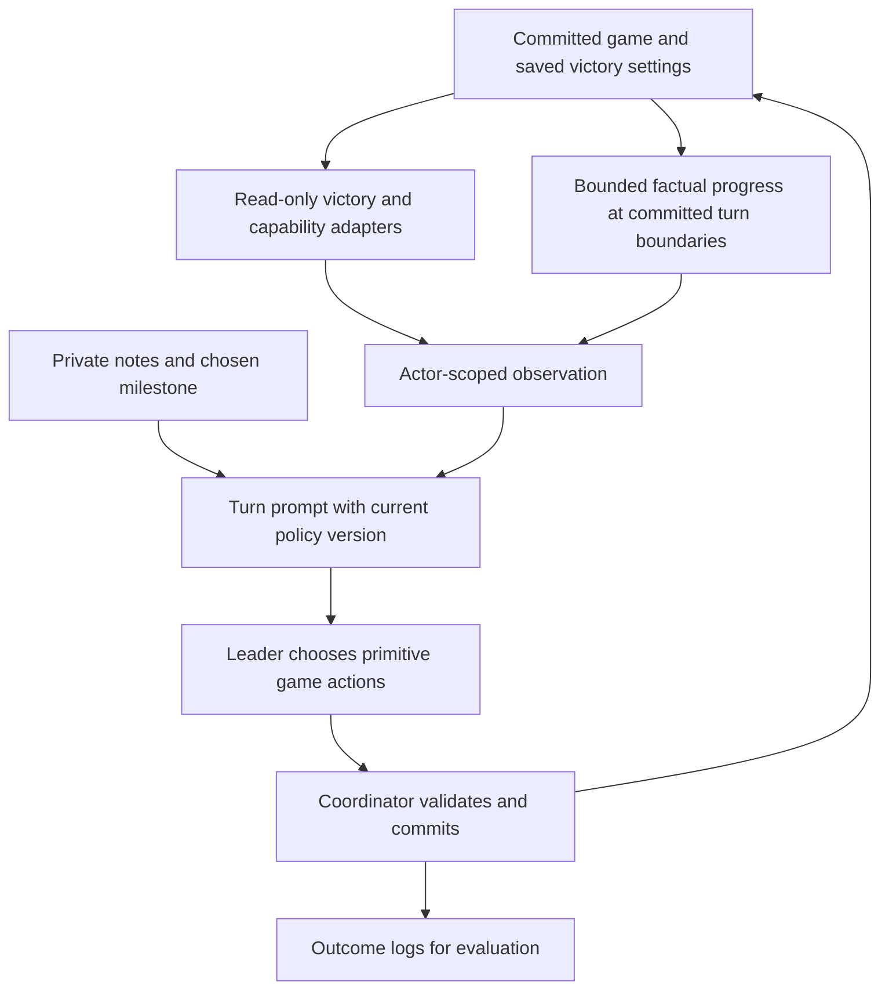
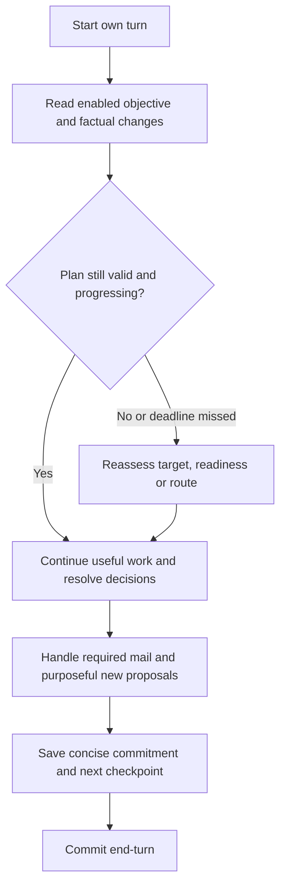
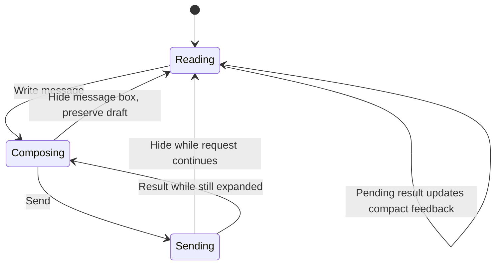

# Agent Victory Progress and Collapsible Message Composer - Plan

## Goal Capsule

**Objective:** Agents pursue a victory the current game can actually award, make measurable progress toward it, and stop spending repeated turns on unchanged diplomatic and unit-management work. Spectators can read messages without the unused send form occupying the window.

**Means:** Expose engine-owned victory facts, retain a short strategic commitment across turns, provide factual progress feedback, revise the conflicting instructions, and collapse the existing composer without replacing its draft lifecycle.

**Authority:** The user's choice to pursue any enabled victory governs R1. Saved game rules and committed engine state govern facts. A leader's notes, correspondence and public narration remain claims, not authoritative game state.

**Delivery:** Implement the composer independently, then the strategy changes in dependency order. Validate on fixtures and isolated copies of the match before updating the installed app. This document authorizes no implementation, live match changes, launches, messages or model-setting changes by itself.

**Stop conditions:** Do not claim improved play from prompt-string tests, fewer messages, more attacks, or a successful end-turn alone. Do not call a run a win without engine victory data. Preserve existing checkpoints and active provider runs.

---

## Product Contract

### Summary

Make the actual winning conditions the organizing objective for each leader. Give leaders the information needed to select targets, distinguish usable forces from nuclear deterrence, and recognize whether their preparations are advancing. Replace routine diplomatic outreach and repeated blocked-unit checks with actions justified by changed conditions. Add a compact, initially collapsed message composer that preserves drafts while giving its space back to conversation history.

### Problem Frame

The initial audit covered 519 completed leader invocations, approximately 104 rounds. It counted 641 applied outgoing messages, 638 applied acknowledgements, 97 attacks and two conquered city-states. No major civilization lost a city. The interval from serial 308 through 519 had no attacks and another 418 messages/replies. All 519 invocations successfully committed their turns, so process liveness was not the failure in that interval.

The later evidence matters: Russia launched another offensive at serial 522. The problem is prolonged strategic stagnation and inefficient preparation, not a permanent inability to declare war.

A checksum-verified checkpoint at serial 524, game round 104, contains `victoryTypes: ["Domination"]`. Earlier agent references to a space victory were therefore pursuing a disabled outcome. The current observation does not expose enabled victories or original-capital identity. Vanilla Domination requires capturing original capitals; score growth, city-state conquest and unrestricted economic development cannot substitute for that objective.

The prompt explicitly prescribes diplomacy every turn and repeatedly tells agents to keep settlers acting. America checked one stranded settler 102 times and applied 66 SLEEP orders to it. The official military ranking also includes large nuclear contributions and a treasury multiplier; it is not a prediction of whether an expedition can take a city.

The supplied screenshot shows the separate UI problem: the always-open recipient, editor, attachment area and send controls consume a large portion of the Messages window even while the user is only reading.

### Key Decisions

- **Pursue any enabled victory.** (session-settled: user-directed — chosen over conquest priority regardless of peaceful alternatives: use whichever enabled route is most achievable.) Governs R1, R2 and R4.
- **Preserve this match's rules.** Its immediate objective remains Domination; exposing other victory definitions must not enable those victories. Governs R1.
- **Use an initially collapsed composer.** This reversible default follows the user's infrequent need to send messages. Governs R9–R12.

### Requirements

**Winning and strategic continuity**

- R1. Leaders select objectives only from victories enabled and available to their civilization in the saved match. They must revise an incompatible old plan on their first turn under the updated policy.
- R2. Observations expose canonical victory requirements, current progress and the next unmet milestone, with enabled status distinct from any missing agent-tool capability.
- R3. Domination context distinguishes original capitals from replacement administrative capitals and exposes known target identity, known ownership and knowledge freshness without revealing hidden locations.
- R4. Every leader retains one primary victory route, a concrete near-term milestone, its expected completion round, assigned resources and a fallback or reassessment condition.
- R5. A missed deadline or three consecutive own turns without progress on the chosen milestone triggers reassessment. Productive travel, healing, research or construction can justify continuation with evidence; the trigger never automatically forces war or blocks end-turn.
- R6. Progress claims distinguish engine facts from model beliefs. Mail volume, revised prose, repeated sleeping orders and raw nuclear-strength growth do not establish strategic success.

**Efficient, credible turns**

- R7. Outgoing diplomacy serves a specific proposal, transaction, changed threat or operational need. Existing required acknowledgements remain explicit and concise; an acknowledgement does not require another outgoing message.
- R8. A leader records a blocked action's reason and recheck condition instead of repeatedly inspecting or reissuing an unchanged order. Relevant changes, threats or a scheduled fallback review permit a fresh check.

**Messages window**

- R9. A visible compact `Write message` control opens the send region; `Hide message box` collapses it. Collapsing gives the released layout height to conversation history while keeping the window's outer position and size unchanged.
- R10. Collapse preserves recipient, text, caret, selection and attachment. A compact `Draft` marker also covers attachment-only drafts. The choice persists through refresh, mailbox close/reopen and window minimize/restore in the same panel lifetime.
- R11. Collapsed inputs cannot retain keyboard focus, accept hidden clicks or leave a recipient popup over the map. Existing text-editing shortcuts and viewer-isolation rules continue to work.
- R12. Pending send/paste operations may finish while collapsed. A failure preserves the draft and remains visible; successful sends clear the draft as today. Collapsing neither sends a message nor cancels an already requested operation.

**Compatibility and evidence**

- R13. Existing saves, notes, message receipts, visibility modes and native game rules remain valid. Any new durable fields have explicit old-save defaults, deep-copy coverage and restore tests.
- R14. Policy identity, game round and factual outcome measurements make before/after comparisons reproducible. Deployment and behavior validation are separate completion gates.

### Success Criteria

Mandatory correctness gates:

- A Domination-only fixture never presents science, culture, diplomacy or time as a permitted winning route.
- The existing command interface can execute a legal capital capture through to engine-recorded Domination victory; city-state and ordinary-city capture do not falsely satisfy capital progress.
- An outdated science plan is replaced with a valid enabled objective in the first updated turn of this match.
- A stalled or missed milestone receives a concrete revised action, target or dated readiness condition rather than another identical preparation summary.
- Hidden composer controls reserve no vertical space; the history viewport gains that space in both Atlas and non-Atlas layouts.
- No regression in mail acknowledgement, draft retention, save restore, visibility filtering or victory-stop behavior.

Behavioral improvement targets for matched evaluation runs, rather than new gameplay rules:

- At least 75% fewer unchanged blocked-unit checks and unchanged SLEEP/FORTIFY orders in the blocked-settler fixture after its initial diagnosis.
- At least 50% fewer unsolicited messages per completed own turn in the stable-border fixture, with required incoming messages still acknowledged and useful trade/war coordination preserved.
- At least 20% lower median time to committed end-turn on matched quiet-turn samples, with no missed mandatory decisions or loss of substantive progress. Report provider and compaction timing separately.
- In three repeats of a favorable assault fixture, at least two capture the designated original capital within eight own turns. In an unfavorable fixture, a concrete alternative or measurable readiness improvement replaces a repeated infeasible assault plan.
- Full-match win rate is a longer evaluation result. A bounded run that does not finish is reported as inconclusive for win rate, even if its efficiency and intermediate progress improve.

### Scope Boundaries

In scope: the composer, objective/clock/capital context, force interpretation, concise private plans, bounded factual progress, policy changes, regression tests, behavioral evaluation and a safe update path.

Considered and not built:

- No attack quotas, mandatory message quotas, automatic declarations or minimum action counts. They reward activity instead of winning and can make a rational defensive turn fail.
- No arbitrary wall-clock kill policy or model/provider changes. The observed runs completed; efficiency and strategy must be measured before changing inference settings.
- No strategic planner service, second agent, global reward score or separate strategy database. Existing engine queries, private notes and coordinator checkpoints provide the needed boundaries.
- No hard cache that rejects repeated reads. Game state can change through other civilizations; initial repetition control belongs in policy and explicit recheck conditions.
- No saving message bodies or attachments in UI settings, no general HUD redesign and no automatic composer expansion when mail arrives.

Deferred to follow-up work: a missing scientific spaceship-assembly action, complete cultural/diplomatic tool-route proofs, generalized mod victories, a full technology encyclopedia, and opponent victory forecasting. Scientific assembly is a real parity gap, but it is not a cause of failure in this Domination-only match. An enabled route with an unsupported mandatory action must be reported as unsupported, never silently relabeled disabled or presented as fully executable.

---

## Planning Contract

### Key Technical Decisions

- KTD1. **Use engine victory semantics.** Build a focused read-only adapter over `VictoryManager.getAvailableVictories()`, milestone predicates and canonical Domination counting. Do not parse translated labels or call victory evaluation/turn advancement from an observation. Implements R1–R3.
- KTD2. **Extend existing observations.** Add a bounded victory summary, the actual `GameInfo.turns` clock and original-capital metadata to the existing read path. Carry richer definitions in a focused `game.rules` victory section only where the compact summary is insufficient. Existing `turnSerial` remains the protocol identity. Implements R2, R3 and R5.
- KTD3. **Retain official Force, explain its limits.** Add conventional and nuclear composition using engine unit classification. Own composition is exact; rival composition is derived only from permitted observations and labeled partial or complete. Tactical judgment continues to use terrain, capture-capable units and existing battle previews. Implements R4 and R6.
- KTD4. **Keep strategic intent in existing private notes.** Adopt a short versioned strategy section inside the existing notes string, with route, milestone, expected round, last observed progress, assignments, next action and blocker/recheck condition. Old free text remains readable as beliefs. Malformed notes trigger a request to refresh the plan, not a failed gameplay turn. No new strategy mutation API or second notes revision is required. Implements R4, R5 and R13.
- KTD5. **Store only bounded factual progress.** Add a small per-civilization window of three completed own-turn summaries to `AgentMatchState`, plus the previous own-turn end snapshot and current-turn baseline. At the next admission, reconcile intervening changes after start-turn effects and expose that incoming delta in the opening observation. Combine it with the actor's subsequent action-turn delta in one completed summary. Publish both boundary updates through the coordinator's existing candidate/commit/checkpoint transaction. Capture selected numeric facts and relevant receipt outcomes, not raw observations or prose. Readers never write history. Implements R5, R6, R13 and R14.
- KTD6. **Treat deadlines as decision points.** Three unchanged own turns is an initial, tunable review threshold. The model must distinguish ongoing measurable work from a stalled plan and revise an infeasible deadline. Keep that review advisory to gameplay legality; do not add a new end-turn gate. Implements R5.
- KTD7. **Collapse a stable composer region.** Reuse the existing input actors and callbacks. Give the send region zero layout height/padding when collapsed, with the compact toggle and any active feedback outside it. Do not invoke whole-window hide/minimize behavior. Preserve expansion only for the panel lifetime initially; cross-restart preference storage is unnecessary for this request. Implements R9–R12.
- KTD8. **Use matched evidence before tuning models.** Record policy and executable/source versions alongside existing run metadata. Compare equivalent initial state, models, reasoning, vision and session policy on isolated timelines. Model-written summaries do not substitute for receipt/checkpoint evidence. Implements R14.

### Strategic Plan and Progress Contract

The note's strategy section is small enough to inspect in one screen. It records canonical victory name, one immediate objective, expected game round, readiness predicate, assigned cities/units, last review round, known blocker and its recheck trigger. A separate short portion retains diplomatic commitments and other useful memory. Keep both within the existing 16 KiB notes limit.

Factual progress summaries contain round and own-turn ordinal, original-capital ownership changes, relevant completed research/construction, available numeric work progress, combat losses/captures and counts of applied action categories. Cover the interval between own turns as well as the actor's commands: a completed regiment, lost assigned unit or recaptured capital must be visible before the next plan is chosen. Aggregate mail/order counts are diagnostic only. Report incomplete historical coverage when loading an old save; do not fabricate three quiet turns from absent history.

At the start of a turn, the model compares its previous commitment to these facts. Progress on an unrelated building is not automatically progress toward the stated milestone. If the chosen objective no longer makes sense, changing it is legitimate but must name the observed reason and the new next action. Long movement or production remains valid when the remaining path/work is advancing. Repeated assertions that an army is preparing do not satisfy the review.

For stalled settlers/workers, record the specific entity, known blocker and event that could change eligibility. Recheck on newly known land, relevant access/border/technology changes, a new threat, completion of work or a bounded fallback interval. A global revision change alone is too broad because unrelated actions increment it every turn.

### High-Level Technical Design

The UI diagram describes visible presentation; request-in-flight state remains independent of expansion. A successful send does not override the user's current expansion choice.

### Sequencing and Assumptions

U1 can land independently. U2 precedes U3 and U4; U5 consumes the verified context and progress contract. U6 verifies delivery into existing provider sessions. U7 runs the end-to-end evaluation after those changes pass their focused checks. Keep separate commits for UI, engine context/progress, policy and evidence so a failed strategy experiment does not block the composer improvement.

The three-turn review window and evaluation targets are reversible initial defaults. Exact helper names and JSON field spelling may follow local conventions, but fields must preserve the meanings and unknown/partial states described here. Changing the game's victory settings, forcing wars or changing model settings remains outside this plan.

---

## Implementation Units

### U1. Collapse the message composer without losing drafts

**Goal:** Recover reading space with one obvious toggle. **Requirements:** R9–R12. **Dependencies:** none.

**Files:** `core/src/com/unciv/ui/screens/worldscreen/status/AgentMessagesPanel.kt`, `core/src/com/unciv/ui/screens/worldscreen/status/AgentPanelLayout.kt`; tests in `tests/src/com/unciv/ui/components/AgentMessagesPanelTest.kt`, `AtlasAgentPanelsTest.kt`, and render fixtures `tests/src/com/unciv/dev/AgentMessagesRenderCheck.kt`, `AtlasFixtureCatalog.kt`. `HudWindow.kt` and `HudWindowTest.kt` are integration references, not a generic window redesign.

**Approach:**

1. Put both skin variants' send controls under a stable collapsible owner. Atlas currently reserves composer/footer height explicitly; non-Atlas currently adds several controls directly to the root.
2. Add a named toggle, draft indicator and compact active-status row. Empty status consumes no space. Follow KTD7 for actor lifetime and layout.
3. Preserve history bottom-follow or the current message/offset through settled-layout restoration. Keep window geometry, conversation filter and send-recipient selection independent.
4. Clear focus only from hidden composer descendants and dismiss its recipient popup. Preserve the existing image-generation, send-generation, viewer-change and disposal guards.
5. Existing in-flight paste may complete into the retained draft without reopening it. Do not reuse `imagesHidden`, which also controls visible history-image loading.

**Test scenarios:**

- Default opening is collapsed, hidden controls are not hittable, history is taller, and outer bounds are unchanged.
- Text-only and attachment-only drafts retain exact recipient/text/caret/selection/image through repeated collapse/expand and refresh.
- Collapse during send failure preserves the draft and visible feedback; successful completion clears the draft without changing expansion state or sending twice.
- Paste completion while collapsed updates the draft indicator; full panel hide, viewer switch and disposal still reject stale callbacks.
- Map shortcuts work after collapse; editor shortcuts remain isolated while expanded; a released movement key is not swallowed.
- Older-message anchoring and bottom-follow survive toggles, incoming mail, image arrival, resizing and minimize/restore.
- Both skins work at 420×600 and normal desktop sizes, including 1.5× font scale, long recipients, images and warnings.

**Verification:** Existing tests that manipulate the composer explicitly open it first. Capture real Atlas and non-Atlas collapsed/expanded/draft states using fake sessions. A CSS/HTML sketch is not implementation evidence.

### U2. Expose the real victory objective and clock

**Goal:** Make disabled routes impossible to mistake for the winning objective. **Requirements:** R1–R3, R13. **Dependencies:** none.

**Files:** new `core/src/com/unciv/logic/agents/AgentVictoryObservation.kt`; existing `AgentObservation.kt`, `AgentRulesCatalog.kt`, `AgentMapObservation.kt`, `AgentMapKnowledge.kt`; shared helpers in `core/src/com/unciv/logic/civilization/managers/VictoryManager.kt` and `core/src/com/unciv/models/ruleset/Victory.kt` only where needed. Runner types/forwarding in `agent-runner/src/fake-game-mcp.ts`, `map-types.ts`, `game-mcp-server.ts`, `compact-results.ts`. Add `tests/src/com/unciv/logic/agents/AgentVictoryObservationTest.kt`; extend `ObservationVisibilityTest.kt`, `AgentRulesCatalogTest.kt`, `AgentMapObservationTest.kt`, and `agent-runner/test/turn-efficiency.test.ts`.

**Approach:**

1. Reuse canonical availability and milestone evaluation, including victories hidden from the ordinary victory screen. Preserve the saved enabled set and name tool-capability limitations separately.
2. Add the actual game round alongside unchanged serial/revision identity. Define deadline comparisons against rounds/own-turn ordinals, never serial divided by civilization count.
3. Expose original-capital facts with current versus remembered ownership provenance. Unknown capital locations remain unknown; finding one becomes an actionable milestone.
4. Provide bounded summaries in the opening observation. Keep optional detailed rules retrieval out of every prompt; preserve false, zero, unknown and partial distinctions through serialization/compaction.

**Test scenarios:**

- Domination-only save exposes only that winning route; enabled Time is included even when its UI presentation is hidden.
- Original capital, replacement capital, defeated founder, third-party ownership, liberation and recapture match canonical progress.
- FOG/MAP do not reveal undiscovered capital locations or current ownership from stale sightings; FULL exposes only its permitted additional information.
- Repeated observations/rules reads leave revision, save content and game state unchanged.
- A mixed external/built-in/human roster and a defeated civilization produce correct round values without assuming five agents.
- Old observations lacking the optional additions remain supported; explicit unsupported/unknown data survives the real MCP response path.

**Verification:** Compare engine output to canonical victory predicates and inspect a real serialized prompt for a copied Domination checkpoint. Do not infer correctness solely from a fake TypeScript object.

### U3. Give leaders a credible view of military readiness

**Goal:** Stop treating nuclear-heavy empire rankings as proof of local attacking strength. **Requirements:** R3, R4, R6, R13. **Dependencies:** U2.

**Files:** `core/src/com/unciv/logic/agents/AgentObservation.kt`; optional focused `AgentMilitaryObservation.kt`; `agent-runner/src/fake-game-mcp.ts`, `compact-results.ts`; tests in `ObservationVisibilityTest.kt`, new `AgentMilitaryObservationTest.kt`, and `agent-runner/test/turn-efficiency.test.ts`.

**Approach:** Preserve official militaryStrength for continuity. Add small capability counts and conventional/nuclear separation under KTD3. Label the evidence scope so a partial enemy force cannot look like the whole enemy army. Use existing local map, health, attack preview and capture legality in campaign planning; add no speculative server-side war optimizer.

**Test scenarios:**

- A large nuclear reserve does not appear as conventional city-capturing strength.
- Damaged units and an expedition with no capture-capable unit are represented accurately; official Force remains unchanged.
- FULL permits complete observed composition; FOG/MAP report partial knowledge without exact hidden arsenals or production queues.
- An unseen enemy has unknown composition rather than an authoritative zero army.

**Verification:** A leader can explain an assault's actual ranged/melee/air requirements from exposed evidence without relying on the global Force ratio.

### U4. Preserve bounded, factual progress across turns

**Goal:** Make repeated preparation assessable from committed outcomes. **Requirements:** R4–R6, R13, R14. **Dependencies:** U2; include U3 facts only where needed.

**Files:** `core/src/com/unciv/logic/agents/AgentMatchState.kt`, `MatchCoordinator.kt`, new focused `AgentStrategicProgress.kt`, `AgentObservation.kt`; runner observation types. Tests in `AgentMatchStateTest.kt`, `MatchCoordinatorTest.kt`, `FileCheckpointStoreTest.kt`, and new `AgentStrategicProgressTest.kt`.

**Approach:**

1. Implement KTD5 using bounded detached records and the existing transaction pipeline. Retain the snapshot after the actor's committed end-turn effects and reconcile it after that actor's next start-turn effects. Publish the incoming delta with the admitted turn before its opening prompt, without appending a completed summary yet. Merge that delta with subsequent own-turn work exactly once when the actor commits end-turn.
2. Track facts available to the acting civilization and the relevant applied receipts. Use stable entity/tech/construction identity so switching queues, recapture or unit replacement cannot masquerade as uninterrupted progress.
3. Preserve live research/construction/travel evidence needed to recognize legitimate long work. Do not turn all economic growth into an arbitrary progress score.
4. Add default-empty fields for existing format-3 saves and deep-copy them. Do not bump the exact-match save version without a tested migration.
5. Keep strategic intent in the existing notes per KTD4. The engine history proves facts; the notes record what the leader meant to achieve.

**Test scenarios:**

- Reads, action retries and a rejected/rolled-back candidate append no summaries; one committed own turn appends exactly one.
- A regiment completed during start-turn processing is present in the opening progress delta before the leader plans.
- An assigned unit lost or an original capital recaptured between own turns is reported at the next admission, using only actor-permitted facts and without inventing an unseen cause.
- Retrying or restoring an admitted turn neither reapplies start-turn effects nor duplicates the incoming delta in the completed history.
- Partial action batches include applied work only; lost acknowledgements do not duplicate progress.
- A long construction/research/travel task shows ongoing work; repeated SLEEP/mail/prose does not establish a completed milestone.
- Old-save restore starts with explicitly incomplete history, then fills normally. Save/reload and timeline forks preserve matching game+notes+history without importing future progress.
- Deep-copy mutation of candidate summaries cannot affect the committed match or another civilization.
- The window stays bounded and does not leak private rival plans or hidden event details.

**Verification:** Exercise actual checkpoint publication/restore, not only DTO serialization. Observation size remains bounded by the existing read budget.

### U5. Replace the instructions that produce diplomatic and inspection loops

**Goal:** Turn the new facts into consistent strategic behavior. **Requirements:** R1, R4–R8. **Dependencies:** U2–U4.

**Files:** `agent-runner/src/game-instructions.ts`, `turn-prompt.ts`, `supervisor.ts`, tool descriptions in `game-mcp-server.ts`; tests in `agent-runner/test/strategy-instructions.test.ts`, `turn-efficiency.test.ts`, `supervisor-loop.test.ts` and existing diplomatic-message tests; `docs/agent-strategy.md`, `docs/agent-messages.md`.

**Approach:**

1. Open each turn with the valid victory route, last commitment and engine progress. Explicitly correct old plans that depend on disabled victories.
2. Replace global-strength-based aggression with local campaign readiness: target original capital, approach, assigned ranged and capture units, required preparation, expected launch round, and fallback.
3. Remove every-turn outreach and every-settler-must-act language from both static instructions and the prompt tail. Preserve necessary exploration/settlement, existing automation semantics and worker progress.
4. Apply R7 to messages and R8 to blocked actions. Preserve the acknowledgement gate; use short replies and batches without losing receipt confirmation or attachment review.
5. Request the concise versioned private strategy section and a short public summary of actual progress, next action and real blocker. Avoid repeated diplomatic/legalistic prose and self-descriptions of reasoning.
6. Apply the reassessment trigger in R5 without adding attack quotas or hard end-turn rejection.

**Test scenarios:**

- A legacy science plan plus Domination-only observation produces an explicit objective-reconciliation prompt.
- Three quiet own turns or a missed deadline produces a reassessment prompt; healthy decreasing construction/travel time does not demand a pointless plan switch.
- No new incoming mail and unchanged borders permit zero outgoing messages. A real new proposal remains possible.
- Unacknowledged mail still blocks end-turn until an applied acknowledgement; rejected/uncertain acknowledgements do not count.
- A known blocked sleeping settler is not instructed to recheck solely because another unrelated action changed the revision; a relevant changed condition requests a fresh inspection.
- Empty, old, malformed and maximum-size notes remain safe and do not become a new end-turn gate.

**Verification:** Prompt-contract tests catch contradictory wording and data omissions; U7 must separately establish model behavior. Do not count literal phrase assertions as a strategy test.

### U6. Deliver the policy safely to ongoing sessions

**Goal:** Ensure the installed runner and resumed leaders actually receive the new policy. **Requirements:** R1, R13, R14. **Dependencies:** U5.

**Files:** `agent-runner/src/daemon.ts`, `provider-spawn.ts`, `supervisor.ts`, `engine-protocol.ts`; `desktop/src/com/unciv/app/desktop/agents/DesktopAgentMatch.kt` where turn context is assembled; tests in `agent-runner/test/provider-spawn.test.ts`, `daemon.test.ts`, `run-logging.test.ts`, `supervisor-loop.test.ts`, and existing session-ownership tests. Update `docs/agent-sessions.md`.

**Approach:** Put a stable strategy-policy version in each fresh turn context and run metadata. Codex/Claude already receive static instructions on each invocation; preserve that and cover other adapters' resumed prompts. Ensure current enabled victory facts override old note beliefs at the next normal turn admission. Keep exact civilization/timeline/session scoping and current compaction/rotation settings. Version awareness does not require forcibly terminating or erasing a session.

**Test scenarios:**

- Fresh and resumed invocations receive the same policy identity and authoritative objective, with no remaining every-turn outreach mandate.
- A copied old save with old notes advances under the new policy without resetting the game or losing messages.
- Restore/fork cannot resume another timeline's future session; private objectives remain civilization-scoped.
- Policy metadata survives logging and compaction; provider completion is not confused with engine victory or post-turn compaction completion.

**Verification:** Inspect packaged runner artifacts and the first normal post-update prompt/log. Updating source alone is not evidence that the running desktop app uses it.

### U7. Prove better play and stage the release

**Goal:** Demonstrate objective progress and less wasted work without damaging the user's match. **Requirements:** R1–R14. **Dependencies:** U1–U6 for combined release; U1 may ship earlier.

**Files:** extend `tests/src/com/unciv/logic/agents/CombatConquestTest.kt`, `EndgameDynamicsTest.kt`, `AgentEngineBridgeTest.kt`; add focused fixtures under `agent-runner/probes/`; add `agent-runner/scripts/strategy-report.mjs` and `agent-runner/test/strategy-report.test.ts`; extend existing logging only where evidence is otherwise missing. Update `docs/agent-strategy.md`, `docs/agent-action-coverage.md`, `docs/agent-acceptance.md` and `docs/agent-sessions.md` with results and limitations.

**Approach:**

1. Add a real observation → legal actions → declaration → coordinated ranged/melee capture → conquest disposition → victory path. Current endgame recognition fixtures are not a substitute for exercising the command surface.
2. Build a read-only report over unique completed calls, expanded batch receipts and checkpoint outcomes. Include game rounds, policy version, substantive progress, unchanged repeated reads/orders, outgoing mail and time-to-commit.
3. Run a short smoke on isolated fixtures, followed by matched baseline/candidate scenarios with the same provider/model/effort/vision/session settings. Keep the current user's save and logs immutable.
4. Evaluate stable borders, blocked settlers, favorable assault, unfavorable assault and outdated disabled-victory notes. Use three repeats where model variability affects the verdict.
5. Continue an isolated late-game checkpoint for five rounds first. If healthy, extend to twenty rounds and assess original-capital progress and deadline decisions. Run a bounded near-victory fixture to prove actual completion; do not wait for an unbounded full match as the only test.
6. At an evaluation budget boundary, stop scheduling additional turns and let an active invocation finish. Record PID/log/session details for any programmatic provider run. Quiet output is never grounds to kill it.
7. Package and install only after validation, using the established isolated build workflow and a normal pause/close boundary. Verify a real first updated prompt and both composer states. Preserve a recoverable checkpoint before replacing the installed app.

**Test scenarios:**

- Report aggregation does not double-count started/completed events, attempted/skipped actions, retried IDs or cumulative provider token usage.
- A city-state capture, a normal city capture and a fake claim of victory cannot count as original-capital success.
- `TurnPhase.COMPLETED` without actual victory data is not reported as a win.
- Model evaluations meet the Product Contract's targets and retain useful diplomacy and legal defensive choices.
- Existing matched baseline failures remain separated from regressions. No historical test total is presumed current.

**Verification:** Publish the exact source/build identity, fixture settings, raw evidence paths, comparison and unresolved limitations. Report implementation, deterministic validation, behavior evaluation, installed build and active-match verification separately.

---

## Verification Contract

No tests or game runs are performed merely to write this plan. During implementation:

- Use the existing isolated JUnit wrapper, `scripts/atlas/check.sh`, with the touched UI and agent test classes, including new tests named above. It keeps verification outputs/build state separate from the running app.
- In `agent-runner`, run `npm run typecheck` and the relevant Vitest files with `npm test -- <test files>`. Run the full runner suite after integrated changes, then the broader affected Kotlin suite once targeted checks pass.
- For actual UI evidence, use `scripts/atlas/render.sh messages --output <absolute evidence directory> --matrix` after production inputs are committed, as required by that script. Extend the fixture for both composer states. Also exercise the dedicated `AgentMessagesRenderCheck` for non-Atlas behavior using its existing isolated classpath workflow.
- Cover 1440×900, 1920×1080, 960×720, 800×500 and 420×600 at 1.0× and 1.5× text scale. Assert real reading-space gain, not just invisible controls.
- Verify the new observation through the real Kotlin bridge and model-facing MCP compaction path; compare canonical engine victory outcomes, save restoration and actual provider prompt contents.
- Execute U7's bounded behavioral comparisons only after deterministic checks pass. Record provider variance and keep raw applied receipts as the basis for reported gains.

The full suite previously had reported baseline failures, but that report is historical. Establish the exact pre-change baseline before attributing a failure to this work. A successful build or clean prompt test does not waive any behavioral or installed-app gate.

---

## Definition of Done

- The user's enabled-victory choice is implemented, and the copied current match targets original capitals rather than a disabled space victory.
- Every implementation unit's listed behavioral scenarios passes, with any independently reproduced baseline failure explicitly separated.
- Real model runs show fewer repetitive messages/checks and credible milestone progress under the fixed evaluation contract.
- The message box is initially collapsed, can be reopened immediately, preserves drafts and feedback, and genuinely increases visible conversation history in both skins.
- Existing saves and notes load, progress state survives restore correctly, and no new visibility or cross-viewer leak is introduced.
- The installed application and runner are verified separately from source/test results before claiming the active match is fixed.
- Temporary experimental production code is removed; documentation describes the final behavior and the deferred science-tool limitation honestly.

## Sources and Grounding

Source checkout inspected: `96bf0268b037d409af43ff4ef5ce9723587e11cd`. Revalidate touched contracts against the actual implementation base before editing.

Match evidence: match `524c90c9-3acc-4c6a-9ddd-990b41228838`, timeline `c207e254-5f83-4b94-90a2-c187c3b81820`; baseline serials 1–519, later offensive at 522, and checksum-valid restored checkpoint generation 76 at serial 524 / game round 104. The checkpoint's saved enabled set is Domination only. Run directories `run-lADQBx`, `run-smTBxf`, `run-wghhKV` and `run-b4oGLe` supply late preparation/offensive examples. Runtime artifacts are external to the repository.

Primary repository evidence: `agent-runner/src/game-instructions.ts`, `turn-prompt.ts`, `compact-results.ts`; `core/src/com/unciv/logic/agents/AgentObservation.kt`, `AgentMatchState.kt`, `MatchCoordinator.kt`; `core/src/com/unciv/logic/civilization/managers/VictoryManager.kt`; `core/src/com/unciv/models/ruleset/Victory.kt`; `android/assets/jsons/Civ V - Vanilla/VictoryTypes.json`; `core/src/com/unciv/ui/screens/worldscreen/status/AgentMessagesPanel.kt`; the tests and build/render scripts named in the units.
